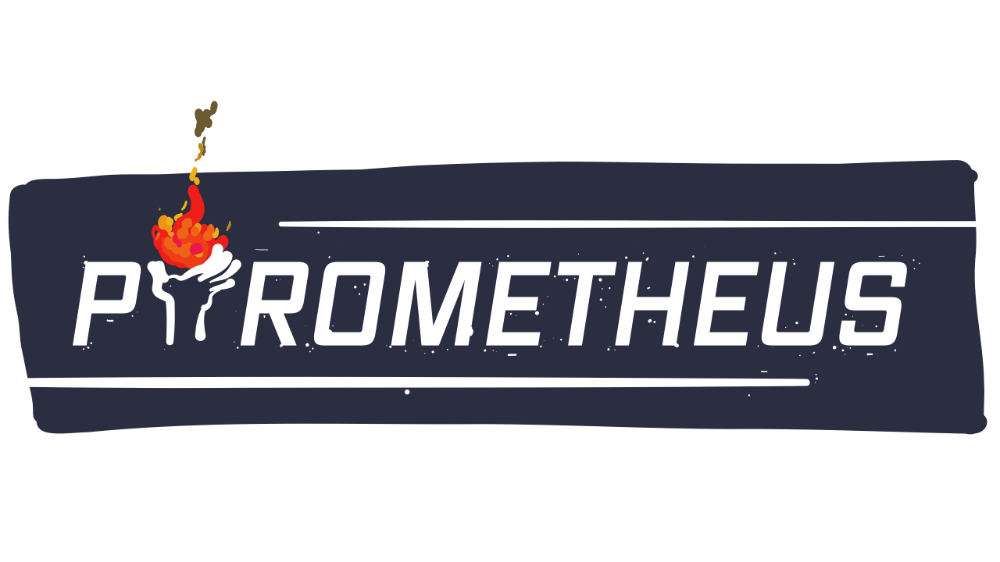

Pyrometheus: Code Generation for Reacting-Flow Thermochemistry
==============================================================

.. image:: https://github.com/pyrometheus/pyrometheus/actions/workflows/ci.yml/badge.svg
    :alt: Github Build Status
    :target: https://github.com/pyrometheus/pyrometheus/actions
.. image:: https://github.com/pyrometheus/pyrometheus/actions/workflows/mfc.yml/badge.svg
    :alt: Github Build Status
    :target: https://github.com/pyrometheus/pyrometheus/actions
.. image:: https://readthedocs.org/projects/pyrometheus/badge/?version=latest
    :alt: Documentation Status
    :target: https://pyrometheus.readthedocs.io/en/latest/?badge=latest
.. image:: https://img.shields.io/pypi/v/pyrometheus
    :alt: Python Package Index Release Page
    :target: https://pypi.org/project/pyrometheus/
.. image:: https://img.shields.io/badge/License-MIT-red.svg
    :alt: MIT License
    :target: https://opensource.org/license/mit
.. image:: https://img.shields.io/badge/arXiv-2503.24286-b31b1b.svg
   :target: https://arxiv.org/abs/2503.24286
   :alt: arXiv:2503.24286
.. image:: https://img.shields.io/badge/DOI-10.1016%2Fj.cpc.2025.109987-blue.svg
   :target: https://doi.org/10.1016/j.cpc.2025.109987
   :alt: DOI:10.1016/j.cpc.2025.109987

.. When you update this description, consider also updating the one in doc/index.rst.

Pyrometheus generates Python, C++ and Fortran code for the thermochemistry
of reacting flows, from mechanisms read by `Cantera <https://cantera.org>`__,
`Mutation++ <https://github.com/mutationpp/Mutationpp>`__ or Plato
(experimental, not public). The generated code is tested against each of
these libraries in every language. Install it from PyPI (``pip install
pyrometheus``) or via `Spack <https://spack.io>`__ (``spack install
py-pyrometheus``)::

    $ python3 -m pip install pyrometheus
    $ python3 -m pyrometheus --help
    usage: pyrometheus [-h] [--version]
                       -l {python,cpp,fortran,python-legacy,cpp-legacy,fortran-legacy}
                       [--library {cantera,mutation,plato}] -m MECH -o OUTPUT -n NAME [-p PHASE]
                       [--state-model STATE_MODEL] [--thermo-database THERMO_DATABASE]
                       [--reaction-set REACTION_SET] [--transfer TRANSFER]
                       [--plato-db-path PLATO_DB_PATH]

    Code generation for thermochemistry, from mechanisms read by Cantera, Mutation++ or Plato.

    options:
      -h, --help            show this help message and exit
      --version             show program's version number and exit
      -l, --lang, --language {python,cpp,fortran,python-legacy,cpp-legacy,fortran-legacy}
                            Language to generate code for. The '-legacy' generators are the deprecated
                            1.x ones, which read Cantera mechanisms only.
      --library {cantera,mutation,plato}
                            Library that reads the mechanism.
      -m, --mech, --mechanism MECH
                            Cantera mechanism file, or the Mutation++ or Plato mixture name.
      -o, --output OUTPUT   Path to the output file.
      -n, --name, --namespace NAME
                            Namespace to use for the generated code.
      -p, --phase PHASE     Cantera: phase to read from the mechanism file.
      --state-model STATE_MODEL
                            Mutation++: state model, such as ChemNonEq1T or ChemNonEqTTv.
      --thermo-database THERMO_DATABASE
                            Mutation++: thermodynamic database, such as NASA-9 or NASA-7.
      --reaction-set REACTION_SET
                            Plato: reaction set.
      --transfer TRANSFER   Plato: energy transfer model, such as TTv.
      --plato-db-path PLATO_DB_PATH
                            Plato: database path (default: $PLATO_DB).

Cite me:

.. code-block:: bibtex

    @article{Cisneros25,
      author = {Cisneros-Garibay, Esteban and {Le Berre}, H. and Adam, D. and Bryngelson, Spencer H. and Freund, Jonathan B.},
      title = {{Pyrometheus: S}ymbolic abstractions for {XPU} and automatically differentiated computation of combustion kinetics and thermodynamics},
      year = {2026},
      volume = {320},
      pages = {109987},
      doi = {10.1016/j.cpc.2025.109987},
      journal = {Computer Physics Communications}
    }

Links:

* `Documentation <https://pyrometheus.readthedocs.io/en/latest/>`__

* `GitHub <https://github.com/pyrometheus/pyrometheus>`__
